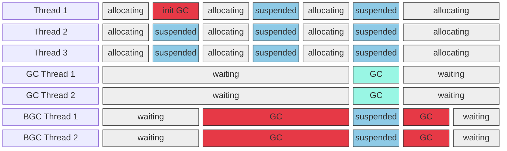

## 后台工作站与服务器 GC

从 .NET Framework 4.5 开始，后台垃圾回收功能可用于服务器上的 GC。 后台 GC 是服务器垃圾回收的默认模式。

后台服务器垃圾回收功能与后台工作站垃圾回收类似，但存在一些差异：

- 后台工作站垃圾回收使用一个专用后台垃圾回收线程，而后台服务器垃圾回收使用多个线程。 通常，每个逻辑处理器都有一个专用线程。
- 与工作站后台垃圾回收线程不同，后台服务器 GC 线程不会超时。

下图显示对独立专用线程执行的后台工作站垃圾回收：

```mermaid
block-beta
  columns 10
  T1["Thread 1"]:2 A1["allocating"]:1 A2["init GC"]:1 A3["allocating"]:1 A4["suspended"]:1 A5["allocating"]:1 A6["Foreground GC"]:1 A7["allocating"]:2
  T2["GC Thread"]:2 B1["waiting"]:1 B2["GC"]:4 B3["suspended"]:1 B4["GC"]:1 B5["waiting"]:1

  T3["Thread 2"]:2 C1["allocating"]:1 C2["suspended"]:1 C3["allocating"]:1 C4["suspended"]:1 C5["allocating"]:1 C6["suspended"]:1 C7["allocating"]:2
  T4["Thread 3"]:2 D1["allocating"]:1 D2["suspended"]:1 D3["allocating"]:1 D4["suspended"]:1 D5["allocating"]:1 D6["suspended"]:1 D7["allocating"]:2

  style A1 fill:#eee,stroke:#333
  style A2 fill:#e63946,stroke:#333
  style A3 fill:#eee,stroke:#333
  style A4 fill:#8ecae6,stroke:#333
  style A5 fill:#eee,stroke:#333
  style A6 fill:#99f6e4,stroke:#333
  style A7 fill:#eee,stroke:#333

  style B1 fill:#eee,stroke:#333
  style B2 fill:#e63946,stroke:#333
  style B3 fill:#8ecae6,stroke:#333
  style B4 fill:#e63946,stroke:#333
  style B5 fill:#eee,stroke:#333

  style C1 fill:#eee,stroke:#333
  style C2 fill:#8ecae6,stroke:#333
  style C3 fill:#eee,stroke:#333
  style C4 fill:#8ecae6,stroke:#333
  style C5 fill:#eee,stroke:#333
  style C6 fill:#8ecae6,stroke:#333
  style C7 fill:#eee,stroke:#333

  style D1 fill:#eee,stroke:#333
  style D2 fill:#8ecae6,stroke:#333
  style D3 fill:#eee,stroke:#333
  style D4 fill:#8ecae6,stroke:#333
  style D5 fill:#eee,stroke:#333
  style D6 fill:#8ecae6,stroke:#333
  style D7 fill:#eee,stroke:#333
```

下图显示对独立专用线程执行的后台服务器垃圾回收：

